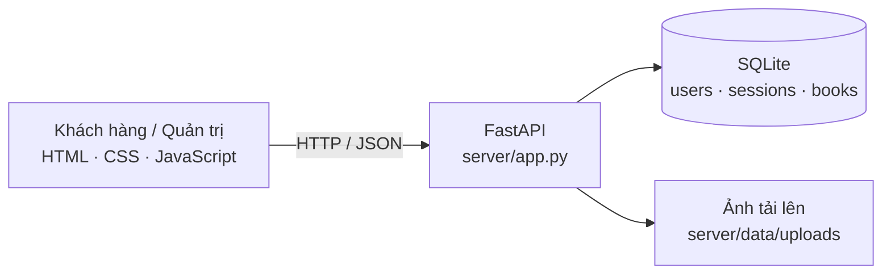
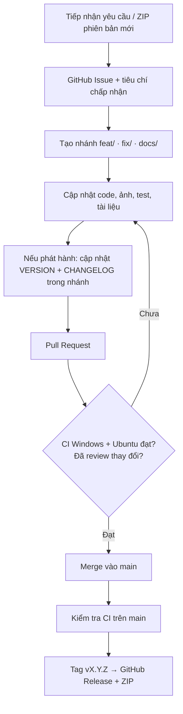

# LTD's Book Store

**CSE3045 · [Hồ sơ Buổi 9](docs/B9.md) · [Kế hoạch cá nhân 4 tuần](docs/05-schedule.md)**

[](https://github.com/s2005on/LTDs-Book-Store/actions/workflows/ci.yml)
[](https://github.com/s2005on/LTDs-Book-Store/actions/workflows/release.yml)

**Website bán sách Toán dành cho học sinh, phụ huynh và người quản lý cửa hàng.** Dự án xây dựng bằng **Python / FastAPI, SQLite, HTML, CSS và JavaScript**, ưu tiên chạy trực tiếp trên Windows để trình diễn đồ án.

**[Tài liệu đồ án](docs/README.md)** · **[Hướng dẫn chạy](START-HERE.md)** · **[Kiểm thử CI](https://github.com/s2005on/LTDs-Book-Store/actions)** · **[Issues](https://github.com/s2005on/LTDs-Book-Store/issues)** · **[Releases](https://github.com/s2005on/LTDs-Book-Store/releases)**

> **Trạng thái mã nguồn — 18/11/2026:** nhánh `main` vẫn là **v0.5.1**. Bản ZIP chạy trên máy **v1.2.1 (Auth Update)** đã được cung cấp riêng, **chưa được nhập đầy đủ vào repository**. Bản ZIP này có giao diện đăng nhập/đăng ký riêng và yêu cầu số điện thoại khi đăng ký; không được coi những chức năng đó đã có trên `main`. Xem [trạng thái đồng bộ](docs/REPO-SYNC-STATUS.md) và [Issue #10](https://github.com/s2005on/LTDs-Book-Store/issues/10). 

## 1. Chức năng của mã nguồn hiện tại

| Dành cho khách hàng | Dành cho quản trị |
|---|---|
| Xem danh mục, tìm kiếm và lọc sách Toán | Đăng nhập tài khoản quản trị |
| Xem thông tin sách và giá bán | Thêm, sửa và xóa sách |
| Giỏ hàng **demo** trên trình duyệt | Tải ảnh bìa JPG/PNG/WebP |
| Đăng ký, đăng nhập và đăng xuất | Cập nhật giá, mô tả, trạng thái |
| Xem sách **sắp ra mắt** (không đặt mua) | Quản lý sản phẩm còn hàng/hết hàng |

**Phạm vi của `main`:** chưa có backend lưu đơn hàng và xử lý đơn hoàn chỉnh. Các chức năng đơn hàng, khuyến mãi, giao diện Art Edition và đăng ký số điện thoại bắt buộc thuộc các bản ZIP local mới hơn, đang chờ [đồng bộ qua Pull Request](docs/VERSION-INTAKE.md). Chưa tích hợp thanh toán trực tuyến hay vận chuyển thực tế.

## 2. Chạy nhanh trên Windows

1. Cài [Python 3.11 trở lên](https://www.python.org/downloads/) và bật **Add Python to PATH** khi cài.
2. Tải hoặc giải nén mã nguồn vào một thư mục độc lập.
3. Nhấp đúp **`RUN-WINDOWS.bat`**.
4. Lần đầu: nhập tên và mật khẩu quản trị theo hướng dẫn trong cửa sổ CMD.
5. Mở website ở **http://127.0.0.1:8017/**.

| Giao diện | URL trên máy tính |
|---|---|
| Trang cửa hàng | http://127.0.0.1:8017/ |
| Đăng nhập | http://127.0.0.1:8017/login.html |
| Quản lý sản phẩm | http://127.0.0.1:8017/admin.html |
| Health check | http://127.0.0.1:8017/health |

Lần chạy đầu cần Internet để cài thư viện trong `.venv`. Dữ liệu phát sinh lưu trong `server/data/`; **sao lưu thư mục này trước khi thay phiên bản**. Hướng dẫn chi tiết: [START-HERE.md](START-HERE.md).

## 3. Kiến trúc hệ thống



Giỏ hàng của phiên bản GitHub hiện tại là chức năng demo tại trình duyệt; không phải một giao dịch đã ghi nhận trong cơ sở dữ liệu.

## 4. Cấu trúc repository

```text
LTDs-Book-Store/
├── .github/
│   ├── ISSUE_TEMPLATE/        # Mẫu báo lỗi, tính năng, tiếp nhận phiên bản
│   ├── PULL_REQUEST_TEMPLATE.md
│   └── workflows/
│       ├── ci.yml             # Test Python/Node trên Windows và Ubuntu
│       └── release.yml        # Test và phát hành ZIP khi có tag
├── server/
│   ├── app.py                 # API FastAPI và SQLite
│   ├── requirements.txt
│   └── web/                   # HTML, CSS, JS, catalog và ảnh sản phẩm
├── tests/                     # Kiểm thử Python + JavaScript
├── scripts/                   # Đóng gói ZIP và xác minh file
├── docs/                      # Hồ sơ đồ án, Sprint, thiết kế, QA và minh chứng
│   └── evidence/              # Quy định lưu ảnh/log kiểm thử đúng phiên bản
├── deploy/                    # Tài liệu triển khai (chưa dùng VPS)
├── RUN-WINDOWS.bat            # Chạy website trên Windows
├── start.py                   # Khởi động môi trường Python
├── VERSION                    # Phiên bản mã nguồn GitHub
└── CHANGELOG.md               # Lịch sử thay đổi
```

## 5. Quy trình phát triển và kiểm soát phiên bản



**Nguyên tắc:** không đẩy mã trực tiếp vào `main` khi đang phát triển; không gắn tag khi ZIP local và mã nguồn GitHub còn khác nhau. Mỗi PR cần có phạm vi, lệnh kiểm thử, ảnh minh chứng khi thay đổi UI và lưu ý bảo mật. Xem [WORKFLOW.md](docs/WORKFLOW.md), [GIT.md](docs/GIT.md) và [VERSIONING.md](docs/VERSIONING.md).

## 6. Kiểm thử và bảo đảm chất lượng

```bash
python -m pip install -r server/requirements-test.txt
python -m unittest discover -s tests -v
node --check server/web/app.js
node --test tests/*.test.cjs
python scripts/package.py
python scripts/verify_package.py
```

GitHub Actions chạy kiểm thử trên **Windows và Ubuntu**, đóng gói và xác minh ZIP theo nội dung `VERSION`. **CI đạt không thay thế kiểm thử trực quan bằng trình duyệt**. Kế hoạch và minh chứng: [TEST-PLAN.md](docs/TEST-PLAN.md), [QUALITY.md](docs/QUALITY.md), [evidence/README.md](docs/evidence/README.md).

## 7. Hồ sơ phục vụ đồ án

| Nhóm | Tài liệu |
|---|---|
| Phân tích yêu cầu | [Project Charter](docs/01-project-charter.md) · [Requirements / User Stories](docs/02-requirements.md) |
| Thiết kế | [System Design](docs/03-system-design.md) · [WBS](docs/04-wbs.md) |
| Quản lý tiến độ | [Schedule](docs/05-schedule.md) · [Scrum](docs/06-scrum-team.md) · [Sprint Tracker](docs/SPRINT-TRACKER.md) |
| Kiểm chứng | [Test Plan](docs/TEST-PLAN.md) · [Ma trận minh chứng](docs/ACADEMIC-TRACEABILITY.md) |
| Báo cáo học phần | [B2](docs/B2-REPORT.md) · [Midterm](docs/MIDTERM.md) · [Final Report](docs/FINAL-REPORT.md) |
| Bàn giao | [Final Handover](docs/FINAL-HANDOVER.md) · [Release Checklist](docs/RELEASE-CHECKLIST.md) |

**[Mở toàn bộ mục lục tài liệu →](docs/README.md)**

## 8. An toàn và giới hạn

- Không commit `.env`, mật khẩu, token, `.venv/`, `server/data/`, file SQLite hoặc dữ liệu khách hàng.
- Chưa triển khai VPS; dịch vụ mặc định chỉ lắng nghe ở `127.0.0.1`.
- Không sử dụng tính năng thanh toán demo để nhận tiền thật.
- Kết quả kiểm thử/báo cáo chỉ được đánh dấu hoàn thành khi có log, commit và minh chứng đúng phiên bản.

© LTD's Book Store — đồ án website bán sách Toán.
